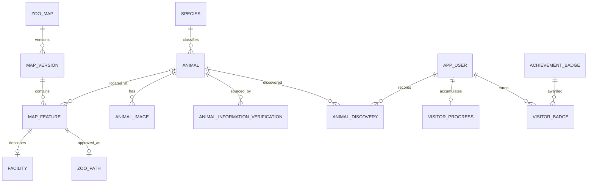

# Dehiwala Zoo backend

The backend is a Spring Boot REST API backed by PostgreSQL/PostGIS. Flyway owns the schema. This increment adds safe, repeatable import of the existing map assets and a read-only GeoJSON endpoint. The Flutter app still uses its existing local data until API integration has been tested.

## Data safety

The source files remain unchanged:
- ../assets/data/waypoints_flutter.json
- ../assets/data/recorded_route.geojson

The importer preserves waypoint IDs and the original waypoint JSON in feature properties. It sets the map feature status from the existing verification/review flags. The current animal-category entries are map observations without animal records or discovery eligibility until zoo staff verifies the identity and enclosure association.

Recorded traces are imported as RECORDED_ROUTE features, retaining their source properties, with UNVERIFIED status and needs_review set. They are not inserted into zoo_path and are not represented as official paths.

Imports use ON CONFLICT upserts on the existing source IDs. The importer validates coordinate ranges and runs in one database transaction.

## Start the services

1. Ensure Docker Desktop is running.
2. Copy .env.example to .env. Replace both password placeholders with the same local development password.
3. Run docker compose -f compose.yaml up --build.
4. Check GET http://localhost:8080/api/v1/health.

The database data uses a named Docker volume. Do not commit the local .env file.

## Import existing map assets

With Maven installed, start the API from the backend directory after the database container is running. Set:

- APP_LEGACY_IMPORT_ENABLED=true
- APP_LEGACY_IMPORT_DATA_DIR=../assets/data
- SPRING_DATASOURCE_URL=jdbc:postgresql://localhost:5432/dehiwala_zoo
- SPRING_DATASOURCE_USERNAME=dehiwala_app
- SPRING_DATASOURCE_PASSWORD=the local password from .env

The importer is disabled by default. Enabling it imports both source files; running it again updates the same IDs.

## Map API

GET /api/v1/map/features returns an active GeoJSON FeatureCollection with original properties and verification/source metadata. Optional viewport filters are minLon, minLat, maxLon, and maxLat; all four must be supplied, with valid longitude/latitude ranges.

No write, admin, authentication, event, announcement, or discovery endpoints are exposed yet. These require the next security and feature increments.
## Flutter API address

The app reads API features with the compile-time ZOO_API_BASE_URL define. For an Android emulator, run Flutter with:

flutter run --dart-define=ZOO_API_BASE_URL=http://10.0.2.2:8080/api/v1/

For web or desktop on the same computer, the default is http://localhost:8080/api/v1/. On a physical phone, use the development computer's LAN address. Local HTTP cleartext is enabled only in Android debug builds; production must use HTTPS. Configure app.cors.allowed-origins for the deployed web client origins.
## Current relational relationships

The first migration focuses on map and wildlife records plus the existing gamification concept. Visitor authentication flows and event/assistance features still need implementation before production use.

map_feature.geometry stores SRID 4326 spatial data and is GIST-indexed. A check constraint limits geometry types by feature kind. verification_status, name_verified, needs_review, and review_note are retained separately. The map API exposes active imported observations, including their verification status; zoo_path is reserved for verified official routes.

## Current API contract

- GET /api/v1/health returns service health.
- GET /api/v1/map/features returns a GeoJSON FeatureCollection. Each feature keeps its source ID, geometry, original properties, feature type, verification state, and review metadata.
- Optional map bounds use minLon, minLat, maxLon, maxLat together. The API validates coordinate ranges and returns HTTP 400 for incomplete or invalid bounds.

CORS origins are configured through APP_CORS_ALLOWED_ORIGINS; the local default covers localhost:5500 and 127.0.0.1:5500. Set the deployed web origin for production.

- GET /api/v1/animals returns only records whose animal verification status is VERIFIED. An optional query parameter searches verified common names. Unverified map labels remain available through the map features API only.